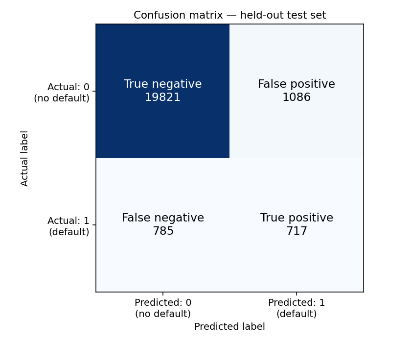
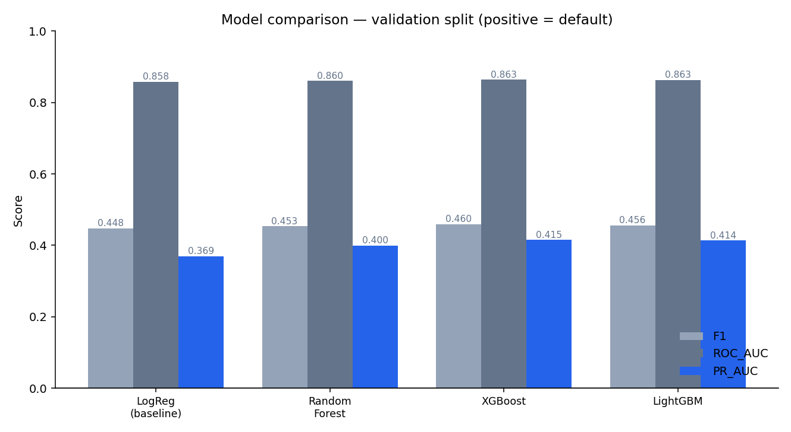
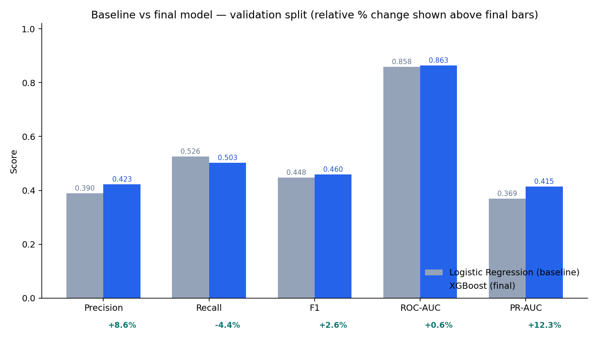

# Loan Recovery Intelligence Platform

A production-style ML platform that predicts which borrowers are most likely to become **seriously delinquent within two years** and prioritizes them for collection/recovery outreach. Built end-to-end on the real Kaggle **"Give Me Some Credit"** dataset (150,000 real borrower records).

> **No fake data, no fabricated results.** All metrics in this repo were measured on the real dataset during the build — see [artifacts/reports/final_project_report.md](artifacts/reports/final_project_report.md).

---

## What's inside

| Layer | Tech |
|---|---|
| Data & features | pandas — leakage-safe, point-wise feature engineering |
| ML modeling | scikit-learn, XGBoost, LightGBM, imbalanced-learn, SHAP |
| Backend | FastAPI + SQLAlchemy (PostgreSQL / SQLite) — 9 endpoints |
| Frontend | React + Vite + TypeScript + Tailwind — 5 pages |
| Infra | Docker Compose (backend + frontend + Postgres) + GitHub Actions CI |
| Tests | pytest (73) + Vitest (8) |

**Final model:** XGBoost. Test split: F1 **0.434**, ROC-AUC **0.865**, PR-AUC **0.394**.

---

## Quick start (local, no Docker)

### 1. Backend

```bash
# create venv + install
python -m venv .venv
.venv\Scripts\activate            # Windows
pip install -r requirements.txt

# data + train (writes models/ and artifacts/)
python scripts/download_data.py   # needs Kaggle API creds; else drop the CSV into data/raw/
python scripts/prepare_data.py
python scripts/train.py
python scripts/evaluate.py

# run API (uses SQLite by default when DATABASE_URL is unset)
python -m uvicorn backend.app.main:app --reload
# Swagger UI → http://localhost:8000/docs
```

### 2. Frontend

```bash
cd frontend
npm install
npm run dev        # http://localhost:5173 (proxies /api → :8000)
npm run build      # production bundle
npm run test:ci    # Vitest
```

---

## Docker (recommended)

```bash
# 1. train the model locally first (Docker image embeds model artifacts)
python scripts/download_data.py
python scripts/prepare_data.py
python scripts/train.py

# 2. configure env
cp .env.example .env

# 3. build + run everything (postgres + backend + frontend)
docker compose up --build
```

- Frontend: http://localhost:5173
- API: http://localhost:8000/docs
- Postgres data persists in the `pgdata` volume.

> **Note:** Docker was **not installed** on the machine where this was developed, so `docker compose up` was not executed live. The compose config passes `docker compose config` validation and image builds run automatically in CI (`docker.yml`). Run it in a Docker-enabled environment.

---

## API endpoints

| Method | Path | Purpose |
|---|---|---|
| GET | `/health` | Liveness + model/DB status |
| GET | `/api/v1/model/info` | Loaded model metadata |
| GET | `/api/v1/model/metrics` | Model performance metrics |
| POST | `/api/v1/predict` | Single-borrower risk prediction |
| POST | `/api/v1/predict/batch` | Batch predictions |
| GET | `/api/v1/borrowers` | List borrowers |
| GET | `/api/v1/borrowers/{id}` | Borrower detail |
| GET | `/api/v1/dashboard/stats` | Dashboard aggregates |
| GET | `/api/v1/recovery/priority` | Recovery queue |
| POST | `/api/v1/explain` | SHAP explanation for a borrower |

Full interactive docs at `/docs`.

---

## Evaluation results

All metrics below were measured on the **real Kaggle "Give Me Some Credit"** dataset (149,390 cleaned records, stratified 70/15/15 split). Nothing is fabricated.

### Model comparison (validation split, positive class = default)

| Model | Accuracy | Precision | Recall | F1 | ROC-AUC | PR-AUC |
|---|---|---|---|---|---|---|
| Logistic Regression (baseline) | 0.9130 | 0.3895 | 0.5263 | 0.4477 | 0.8581 | 0.3693 |
| Random Forest | 0.9218 | 0.4261 | 0.4843 | 0.4534 | 0.8601 | 0.3997 |
| **XGBoost (selected)** | **0.9207** | **0.4230** | **0.5030** | **0.4595** | **0.8634** | **0.4148** |
| LightGBM | 0.9130 | 0.3922 | 0.5443 | 0.4559 | 0.8628 | 0.4138 |

### Final model — held-out test set

| Metric | Value |
|---|---|
| Accuracy | 0.9165 |
| Precision | 0.3977 |
| Recall | 0.4774 |
| **F1** | **0.4339** |
| **ROC-AUC** | **0.8649** |
| **PR-AUC** | **0.3941** |
| Decision threshold | 0.714 |
| Confusion matrix | TN 19,821 · FP 1,086 · FN 785 · TP 717 |

### Improvement over baseline (validation, like-for-like)

| Metric | Baseline (LogReg) | Final (XGBoost) | Relative change |
|---|---|---|---|
| Precision | 0.3895 | 0.4230 | **+8.6%** |
| Recall | 0.5263 | 0.5030 | −4.4% |
| F1 | 0.4477 | 0.4595 | **+2.6%** |
| ROC-AUC | 0.8581 | 0.8634 | **+0.6%** |
| PR-AUC | 0.3693 | 0.4148 | **+12.3%** |

> The XGBoost model trades a small amount of recall for substantially better precision and PR-AUC — the right trade-off for recovery prioritization where false-positive outreach cost matters.

### Confusion matrix (held-out test set, n = 22,409)



### Model comparison chart



### Baseline vs final improvement chart



> Plots generated by `scripts/generate_report_plots.py` from real measured artifacts. Regenerate with: `python scripts/generate_report_plots.py`

---

## Project structure

```
├── backend/            # FastAPI app (routes, services, db, ml loader)
├── frontend/           # React + Vite + TS + Tailwind SPA (5 pages)
├── models/             # trained artifacts (best_model.joblib, metadata — gitignored)
├── artifacts/          # reports, metrics, SHAP plots (measured results)
├── notebooks/          # 01–06 step-by-step notebooks
├── scripts/            # download_data / prepare_data / train / evaluate / run_pipeline
├── src/
│   ├── data/           # loading, validation, cleaning
│   ├── features/       # leakage-safe feature engineering
│   ├── models/         # zoo, tuning, pipeline, error analysis, artifacts
│   ├── evaluation/     # metrics, experiment tracking (JSONL)
│   ├── risk/           # risk engine + recovery priority engine
│   └── explainability/ # SHAP explainer
├── tests/ + backend/tests/
├── .github/workflows/  # test.yml + docker.yml
└── docker-compose.yml
```

---

## Tests & CI

```bash
pytest -v                 # 73 backend tests (data, ML, risk, API, DB)
cd frontend && npm run test:ci   # 8 frontend tests
```

CI (`test.yml`) runs the full backend + frontend suite on push/PR; `docker.yml` trains the model and builds both images.

---

## Data & licensing

- **Source:** Kaggle — *Give Me Some Credit* (150,000 real borrower records).
- The **raw dataset is not committed** to this repository (license terms do not permit redistribution). Run `scripts/download_data.py` with Kaggle credentials, or place the CSV at `data/raw/`.
- Credentials are **never committed** — use environment variables (`.env`, see `.env.example`).

---

## Reports

- [Final project report (real measured values)](artifacts/reports/final_project_report.md)
- [Resume bullets](artifacts/reports/resume_bullets.md)
- [Experiment summary (JSON)](artifacts/reports/experiment_summary.json)
